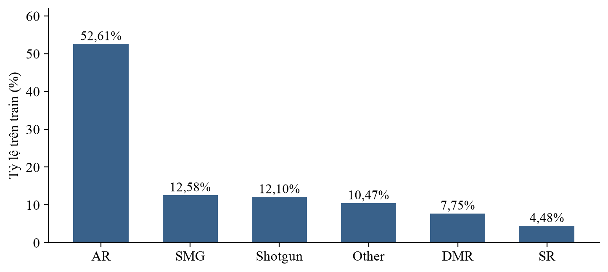
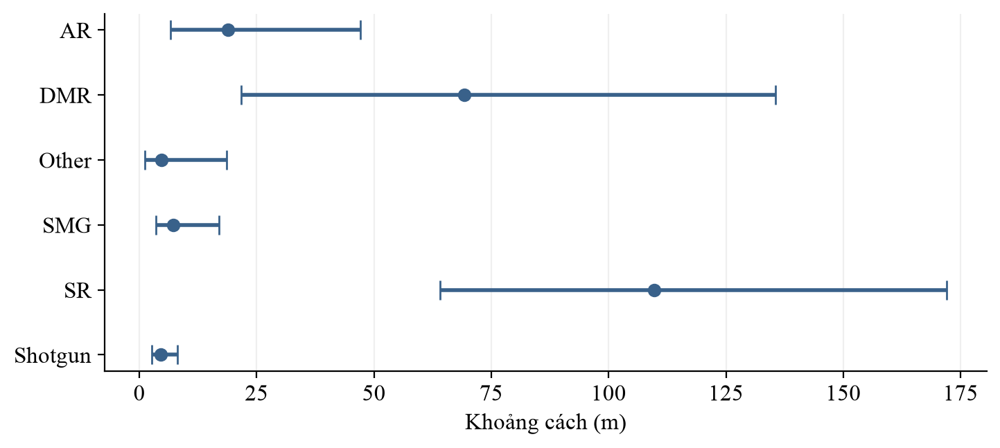
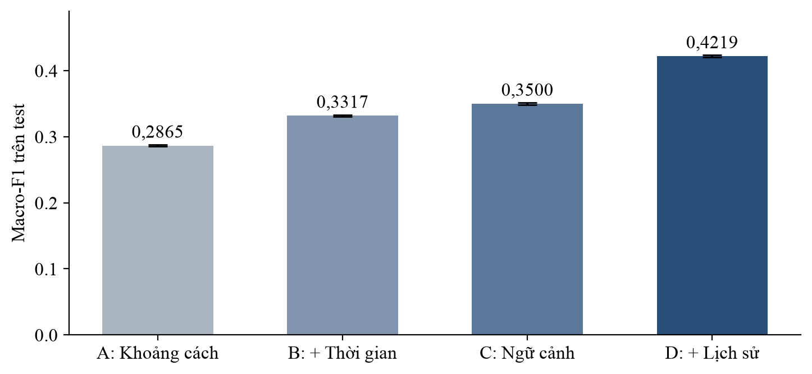
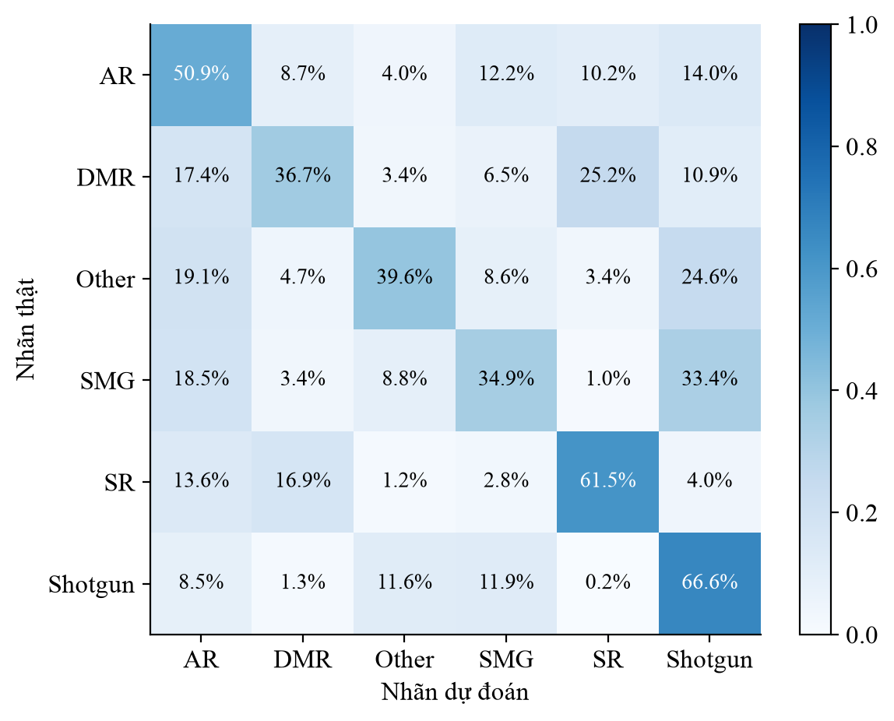
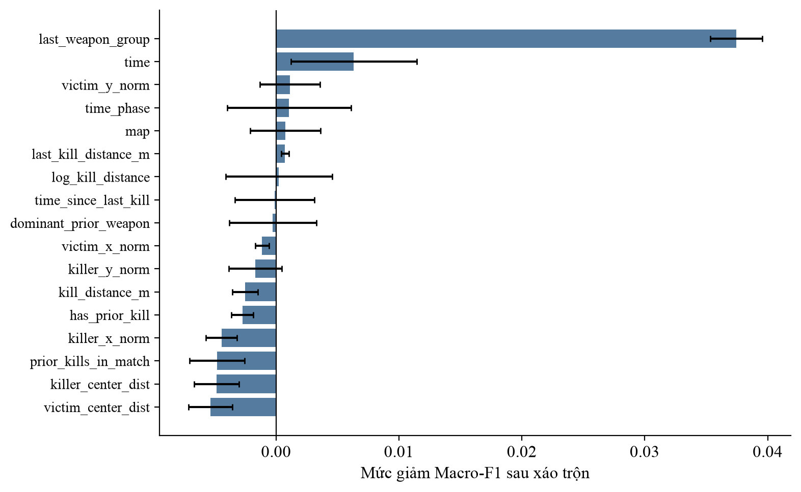
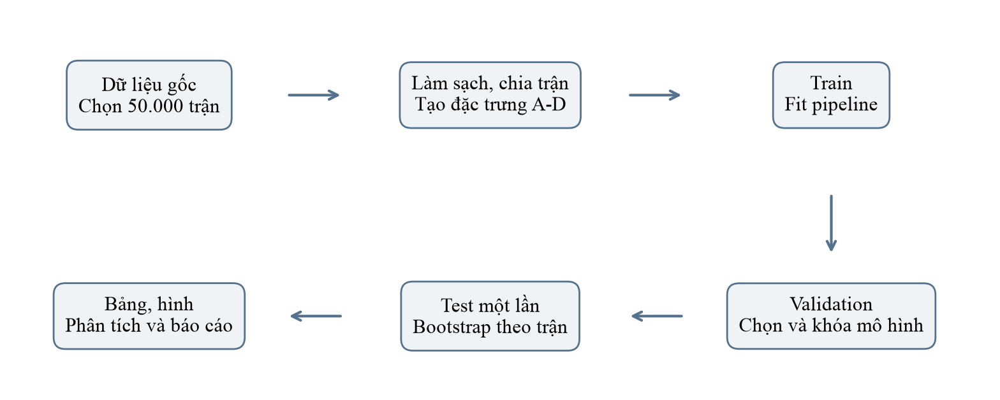
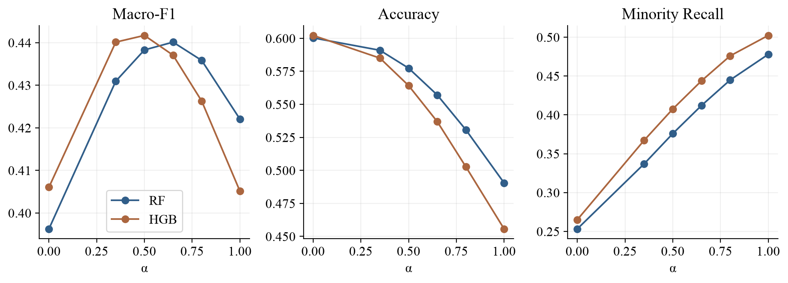

<!-- Bìa và mục lục được tạo tự động khi xuất PDF. -->
<!-- Đại học Phenikaa - Trường Công nghệ Thông tin Phenikaa; Nhóm 3. -->
<!-- Giảng viên: ThS. Phạm Kim Thành. Thành viên giữ nguyên theo report_mau.pdf. -->

# 1. GIỚI THIỆU BÀI TOÁN
## 1.1. Đặt vấn đề
Trong các trò chơi sinh tồn nhiều người chơi, mỗi pha giao tranh đều để lại một dấu vết dữ liệu: người tấn công là ai, nạn nhân ở đâu, sự kiện xảy ra vào thời điểm nào và loại vũ khí nào đã gây ra cái chết. Khi được tổng hợp qua hàng chục nghìn trận đấu, những dấu vết tưởng chừng rời rạc này trở thành nguồn dữ liệu có giá trị để nghiên cứu hành vi chiến đấu và cách người chơi sử dụng trang bị.

Bài toán đặt ra trong bài tập lớn này là: **Từ ngữ cảnh không gian - thời gian của một pha hạ gục và lịch sử đã quan sát trước đó, có thể dự đoán được nhóm vũ khí gây ra sự kiện hay không?** Đây là bài toán phân loại đa lớp có giám sát, đồng thời là một hướng khai phá quy luật từ nhật ký sự kiện của trò chơi PUBG.

Tuy nhiên, khi tiếp cận dưới góc độ Khai phá dữ liệu, bài toán không đơn thuần là đưa một bảng số liệu vào thuật toán rồi đọc độ chính xác. Nhóm phải giải quyết ba rào cản có ảnh hưởng trực tiếp đến chất lượng kết quả.

**Thứ nhất, Sự chồng lấn giữa các tình huống giao tranh:** Khoảng cách là một tín hiệu có ý nghĩa, nhưng không phải quy tắc quyết định tuyệt đối. Một khẩu súng trường tấn công có thể được sử dụng ở cự ly gần; một khẩu súng bắn tỉa vẫn có thể xuất hiện trong tình huống đối đầu trực diện. Vì vậy, cùng một bối cảnh có thể gắn với nhiều nhóm vũ khí khác nhau. Mô hình cần khai thác đồng thời nhiều dấu hiệu thay vì áp đặt công thức “gần là Shotgun, xa là SR”.

**Thứ hai, Sự mất cân bằng giữa các nhóm vũ khí:** Trong tập train cuối cùng, AR chiếm 52,61%, trong khi SR chỉ chiếm 4,48%. Nếu chỉ quan tâm Accuracy, một mô hình luôn dự đoán AR đã có thể đạt trên 52% mà không nhận diện được bất kỳ lớp còn lại nào. Đây là lý do nhóm lựa chọn Macro-F1 làm tiêu chí chính, nhằm đánh giá mức độ nhận diện trên toàn bộ sáu lớp.

**Thứ ba, Ranh giới giữa thông tin hợp lệ và Rò rỉ dữ liệu:** Tên vũ khí hiện tại chính là nguồn tạo nhãn; thứ hạng cuối trận chỉ xuất hiện sau khi trận đấu kết thúc. Đưa các thông tin này vào mô hình sẽ làm sai lệch ý nghĩa của bài toán. Ngay cả lịch sử hạ gục cũng phải tuân thủ thứ tự thời gian: sự kiện ở thời điểm t chỉ được sử dụng thông tin từ những thời điểm nhỏ hơn t.

Từ những yêu cầu trên, nhóm xây dựng một quy trình khép kín, bao gồm kiểm kê dữ liệu, làm sạch, thiết kế đặc trưng, huấn luyện, so sánh mô hình và phân tích lỗi. Trọng tâm của báo cáo là xác định nguồn thông tin nào thực sự giúp ích, mức cải thiện đạt được bao nhiêu và giới hạn của kết quả nằm ở đâu.

## 1.2. Inputs và outputs của Bài toán
- **Đầu vào (Input):** Ngữ cảnh của một sự kiện hạ gục hợp lệ, gồm khoảng cách giữa hai người chơi, thời điểm trong trận, giai đoạn trận, vị trí chuẩn hóa, khoảng cách tới tâm bản đồ và loại bản đồ. Khi người tấn công đã có sự kiện trước đó trong cùng trận, đầu vào được bổ sung các đặc trưng lịch sử tương ứng.
- **Đầu ra (Output):** Một trong sáu nhãn AR, DMR, Other, SMG, SR và Shotgun. Mô hình cũng trả về phân phối xác suất để tính Top-2 Accuracy.

Cột `killed_by` được dùng để xây dựng nhãn `weapon_group`, sau đó bị loại khỏi ma trận đầu vào. `match_id` phục vụ chia tập; tên người chơi phục vụ ghép lịch sử. Các cột này không được sử dụng như đặc trưng dự đoán trực tiếp.

Cần xác định đúng thời điểm của bài toán: hệ thống suy đoán nhóm vũ khí khi ngữ cảnh sự kiện đã được ghi nhận. Đây không phải mô hình dự báo trước một cuộc giao tranh chưa xảy ra, cũng không phải mô hình dự đoán người chiến thắng hoặc thứ hạng cuối trận.

## 1.3. Ý nghĩa của Bài toán
**Về mặt học thuật:** Đề tài cho phép vận dụng các bước cốt lõi của Khai phá dữ liệu trên dữ liệu sự kiện thực tế: chọn mẫu, làm sạch, biến đổi thuộc tính, phân loại, đánh giá và diễn giải tri thức. Đặc biệt, dữ liệu có cấu trúc nhóm theo trận và cấu trúc thời gian theo người chơi, nên việc tổ chức thí nghiệm có vai trò quan trọng ngang với lựa chọn thuật toán.

**Về mặt phân tích trò chơi:** Kết quả giúp mô tả mối liên hệ giữa cự ly giao tranh, diễn biến trận đấu và nhóm vũ khí được sử dụng. Các trường hợp nhầm lẫn cũng cung cấp thông tin: chúng chỉ ra những vùng bối cảnh mà nhiều nhóm vũ khí có hành vi tương tự nhau.

**Về mặt xây dựng hệ thống:** Quy trình có thể làm nền tảng cho công cụ phân tích nhật ký hoặc hỗ trợ kiểm tra dữ liệu thiếu nhãn. Tuy nhiên, khả năng ứng dụng này cần được kiểm chứng thêm trên dữ liệu mới và trong điều kiện đầu vào thực tế; kết quả hiện tại chưa chứng minh hiệu quả của một hệ thống vận hành trực tiếp.

## 1.4. Các hướng tiếp cận bài toán
**Quy tắc theo khoảng cách (Rule-based):** Có ưu điểm dễ hiểu, dễ triển khai. Hạn chế nằm ở việc nhiều nhóm vũ khí cùng xuất hiện trong một khoảng cự ly. Một ngưỡng tĩnh không thể biểu diễn đầy đủ những tình huống chồng lấn này.

**Mô hình chỉ sử dụng ngữ cảnh tức thời:** Kết hợp khoảng cách, thời gian và vị trí để tạo ranh giới phân lớp linh hoạt hơn. Tuy nhiên, mỗi sự kiện vẫn được xem gần như độc lập; mô hình chưa biết người chơi đã sử dụng nhóm vũ khí nào trước đó.

**Mô hình kết hợp lịch sử trong trận:** Bổ sung dấu vết sử dụng vũ khí đã quan sát từ các pha hạ gục trước. Cách tiếp cận này có cơ sở trực quan: vũ khí vừa được sử dụng có thể tiếp tục được sử dụng. Dù vậy, người chơi có thể đổi trang bị; lịch sử chỉ tạo thêm tín hiệu, không bảo đảm nhãn hiện tại giống nhãn trước.

## 1.5. Giải pháp Đề xuất và Câu hỏi nghiên cứu
Giải pháp của nhóm được tổ chức theo bốn tầng đặc trưng A, B, C và D. Từ một đặc trưng khoảng cách ban đầu, nhóm lần lượt bổ sung thời gian, ngữ cảnh đầy đủ và lịch sử hạ gục. Cách thiết kế này cho phép đo phần đóng góp của từng tầng thông tin bằng thí nghiệm loại bỏ/bổ sung đặc trưng (Ablation Study).

Bốn câu hỏi nghiên cứu được đặt ra như sau:

- **Q1:** Chỉ dùng khoảng cách, mô hình có thể nhận diện nhóm vũ khí ở mức nào?
- **Q2:** Thời gian và ngữ cảnh bản đồ/vị trí mang lại mức cải thiện bao nhiêu?
- **Q3:** Lịch sử hạ gục trước thời điểm hiện tại giúp ích như thế nào, đặc biệt với các sự kiện đã có lịch sử?
- **Q4:** Những nhóm nào thường bị nhầm lẫn, và kết quả thay đổi ra sao khi xét hai dự đoán đứng đầu hoặc ba vai trò tầm bắn?

Nhóm khảo sát sáu họ mô hình, lựa chọn bằng Macro-F1 trên validation, sau đó đánh giá một lần trên test đã giữ riêng. Toàn bộ bảng kết quả trong phần thực nghiệm được tổng hợp từ bộ minh chứng đã lưu của dự án [1], [2].

# 2. XÂY DỰNG TẬP DỮ LIỆU
## 2.1. Giới thiệu Dataset
Dataset sử dụng là **PUBG Match Deaths and Statistics**, do tài khoản skihikingkevin công bố trên Kaggle [3]. Trong bài tập lớn này, nhóm khai thác phần dữ liệu sự kiện chết trong tệp `kill_match_stats_final_0.csv`, không sử dụng bảng thống kê tổng hợp cuối trận làm đầu vào cho bài toán chính.

Theo manifest của lần chạy cuối, tệp nguồn có 13.426.348 dòng thuộc 148.308 trận. Nhóm chọn ngẫu nhiên 50.000 trận với seed 42, sau đó giữ toàn bộ sự kiện thuộc các trận đã chọn. Kết quả thu được 4.525.712 sự kiện trước làm sạch. Việc chọn theo trận giúp giữ lại chuỗi sự kiện cần thiết để tính lịch sử.

**Bảng 1. Các trường dữ liệu gốc và vai trò sử dụng**

| Trường hoặc nhóm trường | Nội dung | Vai trò trong quy trình |
|---|---|---|
| killed_by | Vũ khí/nguyên nhân gây chết | Xây dựng nhãn và kiểm kê |
| match_id | Mã trận đấu | Chia tập theo nhóm |
| killer_name, victim_name | Định danh hai người chơi | Làm sạch; ghép lịch sử |
| killer_position_x/y | Tọa độ người tấn công | Tính khoảng cách và vị trí |
| victim_position_x/y | Tọa độ nạn nhân | Tính khoảng cách và vị trí |
| time, map | Thời gian và bản đồ | Đặc trưng ngữ cảnh |
| killer_placement, victim_placement | Thứ hạng cuối trận | Chỉ dùng ở phụ lục hậu nghiệm |

Mỗi dòng là một sự kiện, không phải toàn bộ thông tin của một người chơi. Vì vậy, số lượng dòng lớn hơn nhiều so với số lượng trận. Đọc và xử lý tệp theo từng phần (chunk) giúp kiểm soát bộ nhớ, nhưng các thao tác liên quan đến lịch sử phải dựa trên chuỗi sự kiện đầy đủ của từng trận được lấy mẫu.

## 2.2. Xây dựng nhãn phân loại
Tên vũ khí trong `killed_by` được ánh xạ tường minh sang các nhóm có ý nghĩa. Nếu xuất hiện một tên chưa có trong danh mục, pipeline dừng để kiểm tra thay vì tự gán vào Other. Cách làm này giúp tránh việc che giấu lỗi dữ liệu dưới một nhãn tổng hợp.

**Bảng 2. Ánh xạ nhóm vũ khí sử dụng trong nghiên cứu**

| Nhóm | Ví dụ thành phần | Ghi chú |
|---|---|---|
| AR | AKM, M16A4, M416, SCAR-L, AUG, Groza | Súng trường tấn công |
| DMR | SKS, Mini 14, Mk14, VSS | Nhóm súng trường thiện xạ theo mapping |
| SR | Kar98k, M24, AWM, Win94 | Nhóm súng bắn tỉa theo mapping |
| SMG | Micro UZI, UMP9, Tommy Gun, Vector | Súng tiểu liên |
| Shotgun | S686, S1897, S12K, Sawed-off | Súng shotgun |
| Other | Súng lục, cận chiến, Crossbow, lựu đạn, lửa, xe | Nhóm tổng hợp |
| LMG | DP-28, M249 | Gộp vào Other do dưới ngưỡng 1% |

Tỷ lệ lớp hiếm được xác định chỉ từ train. Nhóm nào chiếm dưới 1% được gộp vào Other; cùng quy tắc được áp dụng sang validation và test. Trong lần chạy cuối, LMG thuộc diện này, nên bài toán còn sáu lớp hoạt động.

Các nguyên nhân như Bluezone, Falling, Drown và RedZone bị loại khỏi bài toán. Riêng `Down and Out` không xác định được vũ khí gây knock ban đầu từ bản ghi hiện có, nên cũng không được suy diễn thành nhãn vũ khí. Cách xử lý này làm giảm số dòng, đồng thời thu hẹp phạm vi kết luận vào những sự kiện có nhãn hợp lệ.

## 2.3. Khám phá Dữ liệu (EDA - Exploratory Data Analysis)
### 2.3.1. Phân tích sự mất cân bằng dữ liệu
**Bảng 3. Phân phối sáu lớp trên tập train sau giới hạn kích thước**

| Nhóm vũ khí | Số sự kiện | Tỷ lệ |
|---|---:|---:|
| AR | 526.120 | 52,61% |
| SMG | 125.786 | 12,58% |
| Shotgun | 121.045 | 12,10% |
| Other | 104.719 | 10,47% |
| DMR | 77.525 | 7,75% |
| SR | 44.805 | 4,48% |
| Tổng | 1.000.000 | 100,00% |

AR có số mẫu lớn hơn SR khoảng 11,74 lần. Mức chênh lệch này tạo ra xu hướng ưu tiên lớp đa số khi tối ưu lỗi tổng thể. Vì vậy, báo cáo luôn trình bày Macro-F1 cùng Accuracy, đồng thời kiểm tra Precision, Recall và F1 của từng lớp.

### 2.3.2. Phân tích khoảng cách hạ gục
Khoảng cách được tính từ chênh lệch tọa độ của hai người chơi, đổi về mét theo quy ước của pipeline. Thống kê mô tả dưới đây được tính trên train, phục vụ quan sát dữ liệu trước đánh giá cuối.

**Bảng 4. Phân bố khoảng cách theo nhóm vũ khí trên train, đơn vị mét**

| Nhóm | Phân vị 25% | Trung vị | Phân vị 75% |
|---|---:|---:|---:|
| AR | 6,59 | 18,84 | 47,07 |
| DMR | 21,70 | 69,27 | 135,59 |
| Other | 1,22 | 4,71 | 18,67 |
| SMG | 3,49 | 7,23 | 16,97 |
| SR | 64,03 | 109,78 | 172,02 |
| Shotgun | 2,64 | 4,52 | 8,16 |

Nhìn vào trung vị, SR và DMR có xu hướng xuất hiện ở cự ly xa hơn; Shotgun, SMG và Other nghiêng về cự ly gần. Tuy nhiên, các khoảng phân vị vẫn giao nhau. Đặc biệt, AR trải trên nhiều khoảng cự ly, giải thích vì sao khoảng cách có giá trị dự đoán nhưng không đủ để tách hoàn toàn các lớp.

### 2.3.3. Đặc điểm của dữ liệu sự kiện và lớp Other
Hai sự kiện trong cùng một trận có thể chia sẻ bản đồ, tiến trình trận đấu và người chơi. Do đó, không thể xem mọi dòng là các quan sát hoàn toàn độc lập. Nếu chia ngẫu nhiên theo dòng, một phần dấu vết của cùng trận có thể xuất hiện ở cả train và test, làm phép đánh giá trở nên dễ hơn so với việc dự đoán trên trận chưa thấy.

Lớp Other cũng có tính chất riêng: nó gom nhiều cơ chế gây chết khác nhau, từ cận chiến đến lựu đạn và xe cộ. Sau khi gộp LMG, lớp này càng không đồng nhất. Vì vậy, kết quả trung bình của Other cần được đọc cùng phân tích thành phần, tránh coi toàn bộ lớp là một loại vũ khí có hành vi thống nhất.

## 2.4. Tiền xử lý Dữ liệu (Preprocessing)
### 2.4.1. Làm sạch và kiểm soát chất lượng
Các quy tắc được áp dụng tuần tự. Số dòng bị loại ở mỗi bước là số dòng còn lại tại thời điểm bước đó chạy; một sự kiện đã bị loại sẽ không tiếp tục được đếm ở bước sau.

**Bảng 5. Số lượng sự kiện qua các bước làm sạch**

| Bước xử lý | Số dòng bị loại | Số dòng còn lại |
|---|---:|---:|
| Dữ liệu lấy mẫu ban đầu | 0 | 4.525.712 |
| Người tấn công thiếu/placeholder | 333.732 | 4.191.980 |
| Tự hạ gục | 63.109 | 4.128.871 |
| Tọa độ không hợp lệ dạng (0, 0) | 114.913 | 4.013.958 |
| Tọa độ hoặc thời gian ngoài miền | 13 | 4.013.945 |
| Bản ghi trùng hoàn toàn | 0 | 4.013.945 |
| Định danh hoặc bản đồ không hợp lệ | 66.180 | 3.947.765 |
| Nguyên nhân bị loại theo mapping | 727.610 | 3.220.155 |

Sau làm sạch, còn 3.220.155 sự kiện hợp lệ, tương đương khoảng 71,15% số dòng lấy mẫu ban đầu. Bước loại nguyên nhân ngoài phạm vi bài toán chiếm phần lớn số dòng bị loại ở cuối quy trình; trong đó có 690.416 dòng `Down and Out` còn lại sau các bước trước.

Miền kiểm tra tọa độ là [0; 800.000], miền thời gian là (0; 2.700] giây theo cấu hình dự án. Quy tắc này là lựa chọn tiền xử lý của nghiên cứu. Những sự kiện bị loại không được đại diện trong kết quả đánh giá cuối cùng.

### 2.4.2. Chia train, validation và test theo trận
Nhóm sử dụng hai lần GroupShuffleSplit để phân chia danh sách trận nguồn theo tỷ lệ mục tiêu 70/15/15 [4]. Việc chia được cố định trước khi lấy các cohort thí nghiệm. Ngoài ra, 2.294 trận từng được sử dụng ở giai đoạn phát triển được loại khỏi danh sách ứng viên test cuối.

**Bảng 6. Quy mô các tập dữ liệu của lần chạy cuối**

| Tập dữ liệu | Số sự kiện | Số trận | Mục đích |
|---|---:|---:|---|
| Train trước giới hạn | 2.255.190 | - | Tính lịch sử trước lấy mẫu train |
| Train thực tế | 1.000.000 | 34.614 | Học tiền xử lý và mô hình |
| Validation | 480.891 | 7.373 | So sánh, chọn cấu hình |
| Test | 484.074 | 7.418 | Đánh giá cuối sau khóa lựa chọn |

Tập train được giảm xuống tối đa một triệu dòng theo tỷ lệ lớp để phù hợp tài nguyên. Validation và test giữ phân phối tự nhiên. Lịch sử được tính trước khi giảm mẫu train, nhờ đó một sự kiện còn lại không bị mất lịch sử chỉ vì sự kiện trước đó không được chọn vào tập train cuối.

Tỷ lệ 70/15/15 là tỷ lệ mục tiêu theo nhóm trận, không phải yêu cầu ba tập phải có đúng tỷ lệ dòng này sau làm sạch và giới hạn train. Pipeline kiểm tra giao nhau giữa các mã trận để bảo đảm cùng một trận không nằm đồng thời ở các tập khác nhau.

### 2.4.3. Biến đổi đặc trưng và nguyên tắc fit trên train
Các biến số đi qua SimpleImputer sử dụng trung vị và StandardScaler; các biến phân loại đi qua OneHotEncoder với cơ chế xử lý giá trị chưa thấy. Những bước có học thống kê được fit trên train trong sklearn Pipeline [5], sau đó dùng nguyên phép biến đổi cho validation và test.

Các mô hình cây không bắt buộc chuẩn hóa thang đo, nhưng dự án dùng chung cấu trúc tiền xử lý để các họ mô hình nhận đầu vào nhất quán. Số đặc trưng gốc của cấu hình D là 17; số cột sau one-hot có thể lớn hơn 17 và không được nhầm với số thuộc tính trước mã hóa.

## 2.5. Thiết kế Đặc trưng (Feature Engineering)
### 2.5.1. Ngữ cảnh không gian - thời gian
Khoảng cách hạ gục được tính theo công thức:

> d = sqrt[(x_k - x_v)² + (y_k - y_v)²] / 100.

Trong đó, k và v lần lượt chỉ người tấn công và nạn nhân. Biến `log_kill_distance = ln(1 + d)` bổ sung một biểu diễn giảm độ lệch của phân phối khoảng cách. Tọa độ được chia cho 800.000; khoảng cách tới tâm bản đồ được tính trong hệ tọa độ đã chuẩn hóa.

Thời gian được sử dụng ở cả dạng số giây và dạng giai đoạn: early khi t < 300, mid khi 300 ≤ t ≤ 1.200 và late khi t > 1.200. Đây là các mốc cố định trong mã nguồn, không được tối ưu bằng test.

**Bảng 7. Bốn cấu hình đặc trưng của thí nghiệm ablation**

| Cấu hình | Số thuộc tính gốc | Thành phần |
|---|---:|---|
| A: distance | 1 | Khoảng cách hạ gục |
| B: context | 2 | A + thời gian dạng số |
| C: full | 11 | B + log khoảng cách, giai đoạn, map và 6 biến vị trí |
| D: loadout_history | 17 | C + 6 biến lịch sử trong trận |

Tên `context` của cấu hình B chỉ tương ứng khoảng cách và thời gian trong mã nguồn. Bản đồ, giai đoạn trận và vị trí chỉ được thêm ở C. Giữ đúng định nghĩa này là điều kiện để diễn giải mức tăng A→B và B→C.

### 2.5.2. Lịch sử hạ gục trước thời điểm hiện tại
**Bảng 8. Sáu đặc trưng lịch sử của cấu hình D**

| Đặc trưng | Ý nghĩa |
|---|---|
| has_prior_kill | Có ít nhất một sự kiện hợp lệ trước đó hay chưa |
| prior_kills_in_match | Tổng số sự kiện hạ gục hợp lệ trước đó |
| last_weapon_group | Nhóm vũ khí phổ biến ở thời điểm có sự kiện gần nhất |
| last_kill_distance_m | Khoảng cách trung bình ở thời điểm gần nhất đó |
| time_since_last_kill | Số giây từ thời điểm gần nhất đến hiện tại |
| dominant_prior_weapon | Nhóm vũ khí xuất hiện nhiều nhất trong toàn bộ lịch sử trước |

Lịch sử được ghép theo cặp `match_id` và `killer_name`, chỉ dùng sự kiện có thời gian nhỏ hơn nghiêm ngặt. Ví dụ, tại giây 120 có hai sự kiện của cùng người chơi thì cả hai đều chỉ được nhìn lịch sử trước giây 120. Chúng không được dùng nhãn của nhau dù nằm ở hai dòng khác nhau trong tệp.

Nếu giây gần nhất có nhiều nhóm vũ khí, hệ thống lấy mode; khi hòa, lấy theo thứ tự chữ cái để kết quả không phụ thuộc thứ tự dòng. Với sự kiện chưa có lịch sử, hai biến nhóm vũ khí nhận `NONE`, khoảng cách trước nhận 0, khoảng thời gian nhận -1 và cờ có lịch sử bằng 0.

Từ “nhân quả” trong tên đặc trưng được dùng theo nghĩa tuân thủ chiều thời gian. Thiết kế này không phải một nghiên cứu suy luận nhân quả về tác động của vũ khí. Nó còn giả định rằng nhóm vũ khí ở các sự kiện trước đã được quan sát; nếu phải dùng nhãn dự đoán thay thế, sai số có thể tích lũy và cần đánh giá riêng.

# 3. CÁC PHƯƠNG PHÁP HỌC MÁY
## 3.1. Majority Baseline - Mốc so sánh lớp đa số
Majority luôn dự đoán lớp phổ biến nhất trên train, trong nghiên cứu này là AR. Đây là mốc tối thiểu để kiểm tra liệu mô hình có học được điều gì ngoài phân phối nhãn hay không.

Ưu điểm của baseline là đơn giản và minh bạch. Hạn chế cũng rất rõ: Recall của năm lớp còn lại bằng 0. Vì vậy, Accuracy tương đối cao của baseline không thể được diễn giải là khả năng nhận diện đầy đủ các nhóm vũ khí.

## 3.2. Logistic Regression (Hồi quy Logistic)
Logistic Regression mô hình hóa xác suất lớp từ tổ hợp tuyến tính của các đặc trưng sau biến đổi. Trong bài toán nhiều lớp, mô hình lựa chọn nhãn có xác suất dự đoán lớn nhất. Nhóm sử dụng trọng số lớp cân bằng và giới hạn tối đa 1.500 vòng lặp.

Vai trò của mô hình này là tạo một mốc tuyến tính có khả năng sử dụng đồng thời các tín hiệu ngữ cảnh và lịch sử. Tuy nhiên, ranh giới giữa các nhóm vũ khí có thể phụ thuộc vào tương tác phi tuyến, chẳng hạn cùng một khoảng cách nhưng khác giai đoạn trận hoặc khác vũ khí đã sử dụng trước đó.

## 3.3. Naive Bayes (Gaussian)
Gaussian Naive Bayes dựa trên định lý Bayes, với giả định độc lập có điều kiện giữa các đặc trưng và phân bố Gaussian cho từng thuộc tính trong mỗi lớp. Mô hình có chi phí tính toán thấp, thích hợp làm mốc xác suất đơn giản.

Trong dữ liệu PUBG, khoảng cách và log khoảng cách có liên hệ trực tiếp; các tọa độ cũng liên quan tới khoảng cách tâm bản đồ. Giả định độc lập vì vậy khó được thỏa mãn đầy đủ. Kết quả của Naive Bayes cần được xem như một phép đối chiếu, thay vì giả định nó sẽ mô tả tốt mọi quan hệ trong dữ liệu.

## 3.4. Decision Tree (Cây quyết định)
Decision Tree chia không gian đặc trưng bằng chuỗi điều kiện. Mỗi nhánh có thể biểu diễn những tình huống như cự ly gần, thời gian đầu trận hoặc nhóm vũ khí trước là Shotgun. Đây là mô hình dễ hình dung và có khả năng học quan hệ phi tuyến.

Nhóm đặt `max_depth=12` và `min_samples_leaf=5`, đồng thời khảo sát hai biến thể không cân bằng và cân bằng trọng số lớp. Giới hạn độ sâu và kích thước lá giúp hạn chế việc cây tạo ra quá nhiều quy tắc quá chi tiết cho tập train.

## 3.5. Random Forest (Rừng ngẫu nhiên)
Random Forest kết hợp nhiều cây được tạo từ các mẫu ngẫu nhiên và lựa chọn đặc trưng ngẫu nhiên trong quá trình chia nhánh [6]. Việc tổng hợp dự đoán giúp giảm sự phụ thuộc vào một cây đơn lẻ.

Trong bài chính, nhóm thử hai cấu hình: 200 cây với tỷ lệ lấy mẫu mỗi cây 0,20; và 300 cây với tỷ lệ 0,15. Cả hai giữ độ sâu tối đa 18 và tối thiểu 5 mẫu ở lá. Hai biến thể cân bằng/không cân bằng được đánh giá trên cùng validation.

Biến thể cân bằng dùng `balanced_subsample`: trọng số lớp được xác định theo mẫu bootstrap của từng cây. Mục đích là tăng mức quan tâm tới các lớp ít mẫu. Đổi lại, mô hình có thể dự đoán nhiều nhãn thiểu số hơn và giảm số sự kiện AR được nhận diện đúng; đây là sự đánh đổi cần được kiểm tra bằng kết quả thực nghiệm.

## 3.6. HistGradientBoosting (Tăng cường Gradient theo Histogram)
HistGradientBoosting xây dựng mô hình theo nhiều vòng, bổ sung cây để cải thiện hàm mất mát của mô hình hiện tại. Cơ chế chia các giá trị số thành bin giúp tìm điểm chia hiệu quả hơn trên dữ liệu lớn [7].

Nhóm thử hai cấu hình chính: 150 vòng, learning rate 0,10, tối đa 31 lá; và 250 vòng, learning rate 0,05, tối đa 15 lá. Early stopping được tắt trong cấu hình dự án. Biến thể cân bằng sử dụng sample weight tính từ train; biến thể plain không áp dụng trọng số cân bằng.

HGB và Random Forest đều xử lý được quan hệ phi tuyến, nhưng cách xây dựng tập hợp cây khác nhau. Việc so sánh hai họ giúp kiểm tra xem dữ liệu phù hợp hơn với tập hợp cây học độc lập hay mô hình được cải thiện tuần tự.

## 3.7. Tiêu chí đánh giá và lựa chọn mô hình
Với mỗi lớp c, Precision phản ánh tỷ lệ dự đoán đúng trong số mẫu được dự đoán là c; Recall phản ánh tỷ lệ nhận diện được trong số mẫu thật sự thuộc c. F1 là trung bình điều hòa của hai đại lượng này.

> Precision_c = TP_c / (TP_c + FP_c); Recall_c = TP_c / (TP_c + FN_c).
>
> F1_c = 2 × Precision_c × Recall_c / (Precision_c + Recall_c).
>
> Macro-F1 = (F1_AR + F1_DMR + F1_Other + F1_SMG + F1_SR + F1_Shotgun) / 6.

Macro-F1 cho mỗi lớp trọng số ngang nhau, phù hợp với mục tiêu nhận diện cả các nhóm ít mẫu. Accuracy đo tỷ lệ dự đoán đúng trên toàn bộ sự kiện; Weighted-F1 là trung bình F1 có trọng số theo support. Các đại lượng này trả lời những câu hỏi khác nhau và cần được đọc đồng thời [8].

Top-2 Accuracy xem nhãn thật có thuộc hai nhãn có xác suất cao nhất hay không. Đây là chỉ số bổ sung cho khả năng thu hẹp lựa chọn, không thay thế độ chính xác của dự đoán một nhãn. Các xác suất của mô hình cũng chưa được kiểm định hiệu chuẩn để diễn giải như độ tin cậy tuyệt đối trong vận hành.

# 4. THỬ NGHIỆM VÀ LỰA CHỌN MÔ HÌNH TỐT NHẤT
## 4.1. Thiết lập thử nghiệm
Lần chạy chính sử dụng một triệu sự kiện train và toàn bộ validation gồm 480.891 sự kiện. Chín biến thể thuộc sáu họ mô hình được khảo sát với cấu hình D. Sau các lượt chọn tham số và ablation, quy trình ghi nhận 16 lượt fit/tuning và 12 pipeline lưu cuối.

Mọi lựa chọn chính được xác định bằng Macro-F1 validation. Khi đã chọn xong, mô hình và danh sách thí nghiệm được khóa trước khi đánh giá test. Nhóm không refit bằng train gộp validation, cũng không đổi mô hình chính dựa trên điểm test.

Môi trường chạy là Kaggle CPU, với scikit-learn 1.6.1, pandas 2.3.3, numpy 2.1.3 và pyarrow 23.0.1. Random seed sử dụng là 42. Bản chạy chính vượt qua 65 kiểm thử tự động; manifest và checksum được lưu cùng kết quả để đối chiếu dữ liệu, mã nguồn và artifact [1].

## 4.2. Kết quả lựa chọn trên Validation
**Bảng 9. Kết quả validation của chín biến thể chính, cùng cấu hình D**

| Mô hình | Macro-F1 | Accuracy | Top-2 |
|---|---:|---:|---:|
| Majority | 0,1150 | 52,68% | 64,81% |
| Logistic Regression balanced | 0,3719 | 41,25% | 64,01% |
| Gaussian Naive Bayes | 0,3196 | 38,95% | 59,80% |
| Decision Tree plain | 0,3866 | 59,53% | 77,60% |
| Decision Tree balanced | 0,3907 | 44,55% | 65,35% |
| Random Forest plain | 0,3968 | 60,03% | 78,48% |
| Random Forest balanced | 0,4227 | 49,10% | 69,23% |
| HistGradientBoosting plain | 0,4060 | 60,22% | 78,65% |
| HistGradientBoosting balanced | 0,4051 | 45,57% | 66,54% |

Mỗi dòng thể hiện cấu hình được giữ lại của biến thể tương ứng, không phải trung bình của các lần thử. Random Forest balanced có Macro-F1 cao nhất trong danh sách khảo sát, đạt 0,422652. Cấu hình được chọn gồm 300 cây, độ sâu tối đa 18, tối thiểu 5 mẫu ở lá, tỷ lệ bootstrap 0,15 và `balanced_subsample`.

HGB plain đạt Accuracy cao hơn, nhưng không được chọn vì tiêu chí chính đã xác định là Macro-F1. Kết quả này cho thấy quyết định “mô hình tốt nhất” phải gắn với mục tiêu đánh giá, không thể thay đổi tiêu chí tùy theo cột số liệu có lợi.

## 4.3. Kết quả trên tập Holdout Test
**Bảng 10. Chỉ số của mô hình Random Forest balanced được chọn**

| Chỉ số | Validation | Test |
|---|---:|---:|
| Macro-F1 | 0,4227 | 0,4219 |
| CI 95% Macro-F1 | [0,4209; 0,4245] | [0,4201; 0,4236] |
| Accuracy | 49,10% | 48,99% |
| Weighted-F1 | 0,5102 | 0,5090 |
| Top-2 Accuracy | 69,23% | 69,15% |
| Tactical Role Macro-F1 | 0,6113 | 0,6103 |
| Tactical Role Accuracy | 63,39% | 63,30% |

Điểm validation và test gần nhau, với chênh lệch Macro-F1 khoảng 0,0008. Trên mẫu train phân tầng 20.000 dòng, Macro-F1 là 0,4535; khoảng cách tới validation là 0,0308. Điểm train này chỉ được tính trên mẫu chẩn đoán, không phải toàn bộ một triệu dòng.

Khoảng tin cậy được ước lượng bằng cluster bootstrap theo trận: lấy lại 7.418 trận test có hoàn lại, giữ toàn bộ sự kiện của mỗi trận được chọn, lặp 1.000 lần. Cách làm này bảo toàn phụ thuộc giữa các sự kiện trong cùng trận tốt hơn việc lấy lại từng dòng độc lập. CI mô tả biến thiên do lấy mẫu trận trong thiết lập đã khóa, không bao quát mọi biến thiên do huấn luyện lại hoặc thay đổi nguồn dữ liệu.

**Bảng 11. So sánh các biến thể trên test sau khi khóa lựa chọn**

| Mô hình | Macro-F1 | Accuracy | Top-2 |
|---|---:|---:|---:|
| Majority | 0,1150 | 52,65% | 64,83% |
| Logistic Regression balanced | 0,3711 | 41,14% | 63,83% |
| Gaussian Naive Bayes | 0,3182 | 38,87% | 59,91% |
| Decision Tree plain | 0,3877 | 59,58% | 77,63% |
| Decision Tree balanced | 0,3901 | 44,43% | 65,32% |
| Random Forest plain | 0,3972 | 60,03% | 78,58% |
| Random Forest balanced | 0,4219 | 48,99% | 69,15% |
| HistGradientBoosting plain | 0,4060 | 60,18% | 78,76% |
| HistGradientBoosting balanced | 0,4048 | 45,51% | 66,49% |

**Nhận xét:** RF balanced vượt majority về Macro-F1, nhưng Accuracy 48,99% thấp hơn 52,65% của majority. Ngược lại, HGB plain và RF plain có Accuracy xấp xỉ 60%, song Macro-F1 thấp hơn mô hình đã chọn. Không có cơ sở gộp Macro-F1 của RF balanced với Accuracy của HGB plain thành một kết quả chung.

Top-2 của majority cũng cần diễn giải thận trọng: mô hình chỉ học lớp phổ biến nhất, còn lựa chọn thứ hai chịu ảnh hưởng của cách xử lý các xác suất bằng nhau. Chỉ số này không đồng nghĩa baseline đã học được một quy luật nhận diện hai nhóm vũ khí.

## 4.4. Thí nghiệm Ablation: Từ khoảng cách đến lịch sử
Để trả lời Q1, Q2 và Q3, nhóm giữ nguyên họ Random Forest, tham số và cơ chế cân bằng của mô hình được chọn. Chỉ tập đặc trưng thay đổi từ A đến D. Nhờ đó, phép so sánh phản ánh đóng góp của thông tin đầu vào trong cùng thiết lập mô hình.

**Bảng 12. Kết quả ablation trên test**

| Cấu hình | Macro-F1 | CI 95% | Accuracy | Top-2 |
|---|---:|---|---:|---:|
| A: khoảng cách | 0,2865 | [0,2851; 0,2881] | 35,09% | 55,22% |
| B: A + thời gian | 0,3317 | [0,3301; 0,3333] | 41,70% | 62,57% |
| C: ngữ cảnh đầy đủ | 0,3500 | [0,3483; 0,3517] | 43,70% | 64,74% |
| D: C + lịch sử | 0,4219 | [0,4201; 0,4236] | 48,99% | 69,15% |

**Bảng 13. Mức tăng Macro-F1 với bootstrap cặp theo trận**

| Phép so sánh | Hiệu Macro-F1 | CI 95% của hiệu số |
|---|---:|---|
| A→B | +0,045218 | [+0,043938; +0,046612] |
| B→C | +0,018226 | [+0,016979; +0,019541] |
| C→D | +0,071931 | [+0,070459; +0,073394] |

**Thứ nhất, Khoảng cách có tín hiệu dự đoán:** A đạt 0,2865 Macro-F1, cao hơn mốc majority 0,1150. Tuy nhiên, mức điểm còn thấp cho thấy chỉ một biến cự ly chưa đủ để xác định nhóm vũ khí.

**Thứ hai, Ngữ cảnh bổ sung tạo ra cải thiện:** Thời gian làm tăng 0,0452 Macro-F1; các biến ngữ cảnh còn lại tăng thêm 0,0182. Cấu hình C đạt 0,3500, nhưng vẫn tồn tại nhiều tình huống có cùng ngữ cảnh mà khác nhãn.

**Thứ ba, Lịch sử mang lại mức tăng lớn nhất trong ba bước:** C→D tăng 0,071931 Macro-F1. CI hiệu số không chứa 0, hỗ trợ kết luận mức tăng dương trong thiết lập này. Đây là hiệu tuyệt đối của điểm Macro-F1; không được viết thành “Accuracy tăng 7,19%”.

Các cấu hình dùng chung mẫu bootstrap để tính hiệu số. Việc nhìn hai CI riêng lẻ có chồng lấn hay không không thay thế phép kiểm tra trực tiếp CI của hiệu số. Ngoài ra, bảng so sánh cặp toàn bộ mô hình trong bộ minh chứng không điều chỉnh đa kiểm định, nên không được diễn giải các CI như một bảo đảm đồng thời cho mọi cặp.

## 4.5. Phân tích nhóm có và không có lịch sử
**Bảng 14. So sánh C và D trên hai nhóm sự kiện test**

| Nhóm sự kiện | Số dòng | C Macro-F1 | D Macro-F1 | C Accuracy | D Accuracy |
|---|---:|---:|---:|---:|---:|
| Chưa có lịch sử | 262.664 | 0,3365 | 0,3315 | 40,71% | 37,56% |
| Có lịch sử | 221.410 | 0,3356 | 0,5160 | 47,25% | 62,55% |

Nhóm có lịch sử chiếm 45,74% test. Trên nhóm này, D đạt Top-2 Accuracy 79,72%; Macro-F1 tăng từ 0,3356 lên 0,5160 so với C. Kết quả phù hợp với giả thuyết rằng dấu vết vũ khí trước đó giúp phân biệt những tình huống có ngữ cảnh hiện tại tương tự nhau.

Tuy nhiên, đối với nhóm chưa có lịch sử, Macro-F1 giảm từ 0,3365 xuống 0,3315 và Accuracy giảm từ 40,71% xuống 37,56%. Những sự kiện này chỉ có các giá trị mặc định ở sáu biến lịch sử. Mô hình D vì vậy không mang lại lợi ích đồng đều cho mọi sự kiện.

Ở đây, “chưa có lịch sử” được hiểu là chưa có sự kiện hợp lệ trước đó trong chuỗi sau làm sạch. Cụm từ này không khẳng định người chơi chưa từng tham gia bất kỳ pha giao tranh hay gây sát thương nào trong trận. Báo cáo dùng đúng phạm vi quan sát của dữ liệu để tránh diễn giải rộng hơn bằng chứng.

## 4.6. Ma trận nhầm lẫn và kết quả từng lớp
**Bảng 15. Precision, Recall và F1 trên test của RF balanced**

| Lớp | Precision | Recall | F1 | Support |
|---|---:|---:|---:|---:|
| AR | 0,7859 | 0,5089 | 0,6178 | 254.854 |
| DMR | 0,3083 | 0,3666 | 0,3349 | 37.640 |
| Other | 0,4563 | 0,3958 | 0,4239 | 50.505 |
| SMG | 0,3165 | 0,3488 | 0,3319 | 60.463 |
| SR | 0,2599 | 0,6148 | 0,3654 | 21.662 |
| Shotgun | 0,3485 | 0,6657 | 0,4575 | 58.950 |

AR đạt F1 cao nhất, nhưng Recall chỉ khoảng 50,89%. SR và Shotgun có Recall tương đối cao, lần lượt 61,48% và 66,57%, trong khi Precision thấp hơn. Điều này cho thấy cơ chế cân bằng đã tăng khả năng bắt các lớp ít mẫu, đồng thời kéo theo nhiều sự kiện của lớp khác bị dự đoán sang chúng.

Các ô ngoài đường chéo cho thấy sự nhầm lẫn vẫn đáng kể. Không có lớp hoạt động nào có F1 bằng 0 trong mô hình cuối, nhưng điều đó không đồng nghĩa mọi lớp đã được nhận diện tốt. SMG và DMR vẫn có F1 chỉ quanh 0,33.

**Bảng 16. Một số hướng nhầm lẫn lớn của lớp AR**

| Nhãn thật → dự đoán | Số sự kiện | Trung vị khoảng cách |
|---|---:|---:|
| AR → Shotgun | 35.746 | 4,64 m |
| AR → SMG | 31.181 | 12,88 m |
| AR → SR | 26.015 | 121,09 m |
| AR → DMR | 22.116 | 77,30 m |

Các hướng nhầm lẫn có liên hệ với cự ly: AR ở rất gần thường bị dự đoán thành Shotgun/SMG; AR ở xa dễ bị dự đoán thành SR/DMR. Đây là dấu hiệu mô hình học được quy luật tầm bắn, nhưng cũng cho thấy giới hạn của quy luật ấy khi một nhóm vũ khí được sử dụng trong nhiều hoàn cảnh.

## 4.7. Phân tích theo khoảng cách và vai trò tầm bắn
**Bảng 17. Kết quả RF balanced theo khoảng cách trên test**

| Khoảng cách | Số sự kiện | Macro-F1 | Accuracy |
|---|---:|---:|---:|
| 0-50 m | 374.991 | 0,3760 | 52,34% |
| Trên 50-150 m | 78.425 | 0,2317 | 37,51% |
| Trên 150-300 m | 26.304 | 0,2276 | 35,80% |
| Trên 300 m | 4.354 | 0,4525 | 46,51% |

Có khoảng 77,47% sự kiện test thuộc khoảng 0-50 m. Khoảng trên 300 m có Macro-F1 cao hơn một số nhóm còn lại, nhưng số mẫu nhỏ và phân phối lớp khác. Không thể từ bảng này kết luận rằng tăng khoảng cách sẽ làm mô hình chính xác hơn đối với cùng một tình huống.

Để khảo sát mức độ phù hợp về vai trò tầm bắn, nhóm quy chiếu nhãn sang ba nhóm: Close_Range gồm Other/SMG/Shotgun; Mid_Range gồm AR; Long_Range gồm DMR/SR. Phép quy chiếu áp dụng lên nhãn dự đoán đã có, không huấn luyện một mô hình ba lớp mới.

Theo cách quy chiếu này, Accuracy đạt 63,30% và Macro-F1 đạt 0,6103. Tuy nhiên, Other là nhóm hỗn hợp, trong đó có LMG đã được gộp; vì vậy ánh xạ này chỉ là quy ước đánh giá thô. Không nên xem mọi thành phần của Other đều có vai trò chiến thuật cận chiến.

## 4.8. Tầm quan trọng của đặc trưng
Permutation importance được đo bằng mức giảm Macro-F1 khi xáo trộn từng thuộc tính, sử dụng 2.000 dòng test và 3 lần lặp. Họ mô hình cây để phân tích đã được chọn trên validation trước đó.

`last_weapon_group` có mức giảm Macro-F1 lớn nhất, trung bình 0,03745 với SD 0,00210. Kết quả này nhất quán với ablation và phân tích nhóm có lịch sử: nhóm vũ khí được quan sát gần nhất chứa tín hiệu dự đoán hữu ích.

Một số thuộc tính có importance nhỏ hoặc âm. Do cỡ mẫu phân tích nhỏ và các đặc trưng có tương quan, không thể xem giá trị âm là bằng chứng chắc chắn thuộc tính đó gây hại. Phân tích này dùng để diễn giải mô hình đã khóa, không phải căn cứ loại biến rồi đánh giá lại trên cùng test.

# 5. THẢO LUẬN KẾT QUẢ
## 5.1. Nhận xét về xử lý dữ liệu mất cân bằng
Kết quả thực nghiệm cho thấy cân bằng lớp tạo ra một sự đánh đổi rõ rệt. Với Random Forest, biến thể balanced đạt Macro-F1 0,4219, cao hơn 0,3972 của plain; trong khi Accuracy giảm từ 60,03% xuống 48,99%. Mô hình đã chuyển một phần khả năng nhận diện lớp đa số sang các lớp còn lại.

Đối với HGB, balanced đạt Macro-F1 0,4048, hơi thấp hơn 0,4060 của plain. Vì vậy, không thể kết luận cứ thêm class weight là Macro-F1 sẽ tăng. Hiệu quả phụ thuộc vào họ mô hình, cường độ trọng số và ranh giới phân lớp của dữ liệu.

Số liệu cũng nhắc lại vai trò của mục tiêu nghiên cứu. Nếu mục tiêu chỉ là tối đa tỷ lệ dự đoán đúng trung bình, một lựa chọn khác có thể phù hợp hơn RF balanced. Trong báo cáo này, ưu tiên là khả năng nhận diện cân đối sáu nhóm vũ khí, nên việc chọn theo Macro-F1 được giữ nhất quán từ validation đến kết luận.

## 5.2. Vai trò của lịch sử và giới hạn thông tin
Mức tăng C→D trên test lớn hơn từng bước tăng A→B và B→C. Điều này cho thấy việc bổ sung một nguồn thông tin liên quan đến người chơi có ích hơn chỉ tiếp tục mô tả bối cảnh hiện tại bằng các thuộc tính đang có.

Tuy nhiên, lịch sử chỉ có giá trị khi tồn tại và đủ đáng tin cậy. Nhóm chưa có lịch sử vẫn chiếm 54,26% test và không được cải thiện trong cấu hình D. Hướng phát triển hợp lý là kiểm tra một cơ chế xử lý riêng hai nhóm trên dữ liệu phát triển mới, thay vì mặc nhiên coi D là phương án tốt nhất cho mọi sự kiện.

Ngoài ra, lịch sử trong nghiên cứu là lịch sử của các sự kiện hợp lệ sau làm sạch, không phải toàn bộ trang bị người chơi đang mang. Người chơi có thể đổi súng, sử dụng vật phẩm khác hoặc có những sự kiện bị loại khỏi dữ liệu. Vì vậy, tên gọi “lịch sử trang bị” chỉ là cách diễn giải đặc trưng suy ra từ nhật ký hạ gục.

## 5.3. Giá trị của quy trình kiểm định
Chia tập theo trận giúp đánh giá trên các trận chưa thấy; khóa lựa chọn trước test giúp giữ vai trò đánh giá cuối của holdout. Hai nguyên tắc này làm kết quả có ý nghĩa hơn việc chỉ báo cáo một điểm số cao trên cách chia thuận tiện.

Bên cạnh đó, ablation sử dụng cùng họ mô hình và cùng tham số, nên mức tăng có thể được gắn với thay đổi tập đặc trưng trong thiết lập cụ thể. Bootstrap cặp theo trận cung cấp thêm thông tin về độ ổn định của hiệu số. Đây là phần cần thiết để chuyển từ nhận xét “điểm có vẻ cao hơn” sang kết luận có căn cứ định lượng.

Dù vậy, các biện pháp trên không chứng minh mọi nguy cơ rò rỉ hay sai lệch đã được loại bỏ. Chia theo trận không đồng nghĩa chia theo người chơi hoặc thời gian lịch; cùng người chơi vẫn có thể xuất hiện ở nhiều trận khác nhau. Khả năng tổng quát hóa theo các hướng đó cần một thiết kế đánh giá riêng.

## 5.4. Hạn chế và Hướng mở rộng Nghiên cứu
**Hạn chế về phạm vi dữ liệu:** Nghiên cứu sử dụng một chunk và dữ liệu lịch sử giai đoạn 2017-2018 theo hồ sơ dự án. Những thay đổi về phiên bản trò chơi, bản đồ, vũ khí hoặc hành vi người chơi có thể làm thay đổi phân phối. Không thể trực tiếp suy rộng kết quả thành độ chính xác trên PUBG hiện tại.

**Hạn chế về nhãn:** `Down and Out` bị loại vì thiếu vũ khí gây knock; dữ liệu không đủ để phân biệt đầy đủ tình huống đồng đội. Lớp Other chứa nhiều cơ chế khác nhau, còn LMG bị gộp theo ngưỡng train. Các lựa chọn này cần được giữ rõ khi so sánh với nghiên cứu dùng tập nhãn khác.

**Hạn chế về thông tin đầu vào:** Mô hình không có toàn bộ thông tin trang bị, địa hình che chắn, hướng nhìn hay chiến thuật. Khoảng cách và lịch sử không thể thay thế hoàn toàn những yếu tố này. Khả năng dự đoán vì thế vẫn có một giới hạn do dữ liệu quan sát.

**Hạn chế về thí nghiệm:** Mô hình chính chỉ khảo sát một số cấu hình, với seed và holdout cố định. Các kết quả bổ sung trên validation giúp hiểu thêm tham số, nhưng không tạo ra một kết quả test mới cho các cấu hình đó.

**Hướng mở rộng:** Thu thập thêm nguồn dữ liệu và đánh giá theo thời gian; kiểm tra khả năng tổng quát hóa sang người chơi chưa thấy; xây dựng cơ chế riêng cho sự kiện chưa có lịch sử; khảo sát cường độ trọng số trung gian trên tập phát triển mới. Nếu triển khai suy luận liên tiếp bằng nhãn dự đoán, cần đo riêng mức tích lũy sai số trong chuỗi.

# 6. XÂY DỰNG QUY TRÌNH PHÂN TÍCH VÀ KHẢ NĂNG ỨNG DỤNG
## 6.1. Tổng quan Hệ thống
Sản phẩm hiện có của dự án là pipeline Python xử lý dữ liệu, huấn luyện và đánh giá, cùng bộ bảng/hình phục vụ phân tích [9]. Quy trình này được chia thành các mô-đun để mỗi bước có đầu vào, đầu ra và bằng chứng kiểm tra rõ ràng.

Dữ liệu gốc đi qua kiểm kê và lấy mẫu theo trận, sau đó làm sạch, ánh xạ nhãn, chia tập và tạo đặc trưng. Pipeline học từ train; validation quyết định lựa chọn; test chỉ được sử dụng ở bước đánh giá cuối sau khi khóa mô hình.

## 6.2. Kiến trúc và các mô-đun chính
**Bảng 18. Các thành phần thực hiện trong dự án**

| Thành phần | Chức năng |
|---|---|
| 01_eda.py | Đọc dữ liệu theo chunk, kiểm kê, chọn trận |
| 02_preprocess.py | Làm sạch, chia tập, ánh xạ nhãn, tạo đặc trưng |
| 03_models.py | Huấn luyện, chọn tham số, ablation |
| 04_evaluation.py | Đánh giá test đã khóa, xuất chỉ số và hình |
| 05_diagnostics.py | Chẩn đoán validation và khoảng cách train-validation |
| 07_appendix.py | Thí nghiệm bổ sung chỉ trên train/validation |
| src/pubg_weapon | Các hàm xử lý dữ liệu và mô hình dùng chung |

Mô hình được lưu cùng metadata, danh sách thí nghiệm và thông tin lựa chọn. Các manifest ghi số dòng, số trận, nhãn và checksum; nhờ đó có thể kiểm tra một bảng kết quả đang thuộc đúng lần chạy hay không.

## 6.3. Kiểm soát tái lập và tài nguyên
Lần chạy chính hoàn thành trong 4.345,20 giây, tương đương khoảng 72,42 phút, gồm kiểm thử, EDA, tiền xử lý, huấn luyện, chẩn đoán và đánh giá. Thời gian này không bao gồm chờ cấp máy Kaggle. Lượt fit/predict/proba của RF được chọn mất 239,53 giây.

RSS đỉnh của tiến trình cha là 5.177,63 MiB, tương đương khoảng 5,06 GiB. Đây là mức đỉnh tích lũy của tiến trình, không phải RAM riêng của từng mô hình hoặc mức đỉnh toàn máy. Báo cáo sử dụng đúng phạm vi đo để tránh suy diễn sai yêu cầu tài nguyên khi triển khai.

Cơ chế đánh giá tạo marker bắt đầu và hoàn tất, đồng thời kiểm tra checksum trước khi chạy. Thí nghiệm phụ lục chỉ đọc train/validation đã đóng băng. Khi viết báo cáo, nhóm dùng lại CSV và hình đã lưu, không chạy lại dự đoán hoặc mở lại test để lựa chọn mô hình.

## 6.4. Khả năng ứng dụng và điều kiện triển khai
Pipeline có thể được mở rộng thành công cụ phân tích nhật ký theo lô: nhận sự kiện, tính đặc trưng theo đúng thứ tự thời gian, đưa ra nhóm vũ khí dự đoán và thống kê phân bố. Bộ ma trận nhầm lẫn, chỉ số theo cự ly và bảng lịch sử có thể hỗ trợ người phân tích xác định vùng dữ liệu khó.

Để xây dựng một giao diện phục vụ người dùng, cần bổ sung lớp nhập dữ liệu, quản lý trạng thái lịch sử theo trận/người chơi và hiển thị xác suất một cách phù hợp. Đồng thời cần đo độ trễ, thông lượng, tính ổn định và độ hiệu chuẩn. Các hạng mục này là hướng triển khai tiếp theo; dự án hiện tại chưa có bằng chứng vận hành một ứng dụng web thời gian thực.

# 7. KẾT LUẬN
Bài tập lớn “Dự đoán nhóm vũ khí gây chết trong PUBG từ ngữ cảnh không gian - thời gian và lịch sử hạ gục” đã xây dựng được một quy trình khai phá dữ liệu hoàn chỉnh, từ dữ liệu sự kiện thô đến mô hình và phân tích kết quả. Trên mẫu 50.000 trận, nhóm thu được 3.220.155 sự kiện hợp lệ sau làm sạch, huấn luyện với một triệu dòng và đánh giá trên 484.074 sự kiện test thuộc 7.418 trận.

Thông qua khảo sát sáu họ mô hình, Random Forest balanced được chọn bằng Macro-F1 validation. Trên test, mô hình đạt Macro-F1 0,4219, CI 95% [0,4201; 0,4236], Accuracy 48,99% và Top-2 Accuracy 69,15%. Kết quả cho thấy khả năng nhận diện nhiều lớp tốt hơn baseline theo Macro-F1, đồng thời bộc lộ sự đánh đổi khi Accuracy thấp hơn mô hình luôn dự đoán AR.

Đóng góp nổi bật của nghiên cứu nằm ở cách tổ chức và kiểm chứng lịch sử hạ gục theo đúng thứ tự thời gian. So với cấu hình chỉ có ngữ cảnh đầy đủ, bổ sung lịch sử làm tăng 0,071931 Macro-F1 trên test, với CI hiệu số hoàn toàn dương. Mức cải thiện tập trung ở nhóm đã có lịch sử, đạt Macro-F1 0,5160; nhóm chưa có lịch sử chưa được cải thiện.

Bốn câu hỏi nghiên cứu đã được trả lời bằng các bảng ablation, phân tích nhóm và phân tích lỗi. Khoảng cách có tín hiệu nhưng chưa đủ; ngữ cảnh bổ sung giúp cải thiện; lịch sử đóng góp rõ hơn trong các sự kiện phù hợp; những nhầm lẫn còn lại thể hiện sự giao thoa giữa các nhóm vũ khí theo cự ly.

Từ kết quả trên, nhóm rút ra rằng chất lượng khai phá dữ liệu phụ thuộc đồng thời vào định nghĩa bài toán, chất lượng nhãn, thời điểm thông tin xuất hiện và cách đánh giá. Một mô hình có điểm số cao chỉ thực sự có ý nghĩa khi nguồn thông tin và phạm vi kết luận được xác định rõ. Đây cũng là cơ sở để tiếp tục mở rộng dữ liệu, cải thiện nhóm chưa có lịch sử và kiểm chứng khả năng ứng dụng trong các điều kiện mới.

---------- HẾT NỘI DUNG CHÍNH ----------

# PHỤ LỤC A. DANH MỤC ĐẶC TRƯNG VÀ NGUỒN KẾT QUẢ
## A.1. Danh mục 17 thuộc tính gốc của cấu hình D
**Bảng A1. Các thuộc tính đầu vào trước one-hot encoding**

| Nhóm thông tin | Thuộc tính |
|---|---|
| Khoảng cách | kill_distance_m; log_kill_distance |
| Thời gian và bản đồ | time; time_phase; map |
| Vị trí người tấn công | killer_x_norm; killer_y_norm; killer_center_dist |
| Vị trí nạn nhân | victim_x_norm; victim_y_norm; victim_center_dist |
| Lịch sử số lượng | has_prior_kill; prior_kills_in_match |
| Lịch sử nhóm vũ khí | last_weapon_group; dominant_prior_weapon |
| Lịch sử cự ly/thời gian | last_kill_distance_m; time_since_last_kill |

Các cột bị cấm làm đầu vào trực tiếp gồm `killed_by`, `cause_for_audit`, `weapon_group`, `match_id`, `killer_name` và `victim_name`. Ba biến placement chỉ được bật ở thí nghiệm hậu nghiệm của Phụ lục C.

## A.2. Đối chiếu bảng và bộ minh chứng
Các đường dẫn dưới đây tính tương đối từ thư mục bộ minh chứng của báo cáo. Thư mục này có tên pubg-report-evidence-20261023, nằm trong reports. Các bảng được làm tròn để trình bày; CSV gốc giữ độ chính xác đầy đủ.

**Bảng A2. Nguồn số liệu chính**

| Nội dung | Tệp nguồn trong bộ minh chứng |
|---|---|
| Quy mô và chia tập | main/processed/dataset_manifest.json |
| Làm sạch | main/processed/cleaning_counts.csv |
| Phân phối lớp train | main/processed/train_class_counts.csv |
| Khoảng cách train | main/validation/train_distance_by_class.csv |
| Chọn mô hình | main/models/selection.json |
| Kết quả validation | main/models/validation_metrics.csv |
| Kết quả test | main/test/test_metrics.csv |
| Ablation và mức tăng | main/test/ablation.csv; ablation_gains.csv |
| Hai nhóm lịch sử | main/test/history_subset_metrics.csv |
| Từng lớp và lỗi | main/test/per_class_metrics.csv; confused_pairs.csv |
| Ma trận và importance | main/test/confusion_matrix.csv; feature_importance.csv |
| Các thí nghiệm bổ sung | appendix-c/ và APPENDIX_C_RESULTS.md |

# PHỤ LỤC B. ĐỐI CHIẾU CÂU HỎI NGHIÊN CỨU
**Bảng B1. Tóm tắt kết quả trả lời bốn câu hỏi nghiên cứu**

| Câu hỏi | Bằng chứng | Kết luận trong phạm vi nghiên cứu |
|---|---|---|
| Q1: Vai trò khoảng cách | A đạt Macro-F1 0,2865 | Có tín hiệu nhưng chưa tách tốt sáu lớp |
| Q2: Vai trò ngữ cảnh | A→B +0,045218; B→C +0,018226 | Thời gian và ngữ cảnh thêm thông tin hữu ích |
| Q3: Vai trò lịch sử | C→D +0,071931; nhóm có lịch sử đạt 0,5160 | Lợi ích tập trung ở các sự kiện đã có lịch sử |
| Q4: Nhầm lẫn và vai trò | AR nhầm theo cự ly; Top-2 69,15%; role accuracy 63,30% | Có quy luật tầm bắn, nhưng nhiều lớp vẫn chồng lấn |

Bốn câu trả lời trên sử dụng cùng tập nhãn sáu lớp và cùng test đã khóa. Không lấy điểm của các thí nghiệm cũ có bảy lớp để tính mức tăng trực tiếp, vì khi thay số lớp và cách gộp nhãn, ý nghĩa của Macro-F1 cũng thay đổi.

Đối với nhóm Other, phân tích thành phần trên test cho thấy chênh lệch đáng kể: Punch có Accuracy khoảng 82,63%; melee khoảng 76,64%; trong khi nhóm grenades_fire chỉ khoảng 4,84%, Crossbow khoảng 20,51% và LMG được gộp khoảng 16,49%. Đây là Accuracy trong từng thành phần của nhãn Other, không phải F1 của các lớp độc lập.

Các con số trên cho thấy cùng một nhãn tổng hợp có thể che giấu những vùng kết quả rất khác nhau. Một hướng nghiên cứu tiếp theo là xem xét lại cách tổ chức nhãn khi có đủ dữ liệu và một tập đánh giá mới, thay vì chỉ cố cải thiện điểm trung bình của Other.

# PHỤ LỤC C. THÍ NGHIỆM BỔ SUNG TRÊN VALIDATION
## C.1. Mục đích và phạm vi
Phụ lục này trình bày các thí nghiệm hoàn tất sau khi kết quả chính đã khóa, nhằm khảo sát thêm siêu tham số, cường độ trọng số lớp và ảnh hưởng của thông tin thứ hạng. Toàn bộ sử dụng train một triệu dòng và validation 480.891 dòng đã đóng băng; không đánh giá lại holdout và không thay mô hình chính [2].

Kết quả validation cao hơn trong phụ lục là bằng chứng về khả năng cải thiện trong không gian khảo sát bổ sung. Nó không phải điểm test của một mô hình mới, cũng không được thay vào bảng kết quả chính.

## C.2. GridSearchCV với GroupKFold
RF và HGB được khảo sát riêng, mỗi họ có 12 tổ hợp tham số, đánh giá bằng GroupKFold 3 phần theo `match_id`. Các trọng số được tính lại trong từng lần fit. Sau khi chọn tổ hợp có Macro-F1 CV tốt nhất, mô hình được refit trên train rồi chấm validation.

**Bảng C1. Kết quả tốt nhất của hai lưới tham số**

| Họ | Tham số được chọn | Macro-F1 CV ± SD | Macro-F1 validation | Accuracy validation |
|---|---|---:|---:|---:|
| RF | 300 cây; depth 22; leaf 5; max_samples 0,15 | 0,432913 ± 0,000628 | 0,431908 | 51,20% |
| HGB | 150 vòng; learning rate 0,10; 63 lá; leaf 50 | 0,408334 ± 0,001025 | 0,407183 | 45,78% |

SD trong bảng là độ lệch chuẩn giữa ba fold, không phải CI 95%. RF ở phụ lục dùng trọng số lớp cố định với α=1 trong từng fold; cơ chế này khác `balanced_subsample` của RF chính. Vì vậy, mức chênh lệch không chỉ phản ánh thay đổi độ sâu cây.

## C.3. Cường độ trọng số lớp và sự đánh đổi
Trọng số của lớp c được tính theo công thức:

> w_c = [N / (K × N_c)]^α, với α thuộc {0; 0,35; 0,50; 0,65; 0,80; 1}.

N là số mẫu train của lần fit, K là số lớp và N_c là số mẫu lớp c. α=0 tương ứng không tăng trọng số theo độ hiếm; α=1 tương ứng nghịch đảo tần suất đầy đủ. Trong thí nghiệm này, trọng số không được chuẩn hóa lại hoặc cắt ngưỡng.

Minority được xác định từ train bằng điều kiện tỷ lệ lớp < 1/K. Với K=6, năm lớp minority là DMR, Other, SMG, SR và Shotgun. Minority Recall là trung bình không trọng số của Recall năm lớp này trên validation.

**Bảng C2. Kết quả khảo sát 12 điểm trọng số trên validation**

| Họ | α | Macro-F1 | Accuracy | Minority Recall |
|---|---:|---:|---:|---:|
| RF | 0,00 | 0,396265 | 60,03% | 0,253267 |
| RF | 0,35 | 0,430938 | 59,09% | 0,337038 |
| RF | 0,50 | 0,438282 | 57,74% | 0,375964 |
| RF | 0,65 | 0,440113 | 55,71% | 0,412053 |
| RF | 0,80 | 0,435822 | 53,07% | 0,444869 |
| RF | 1,00 | 0,422055 | 49,05% | 0,477945 |
| HGB | 0,00 | 0,406042 | 60,22% | 0,265113 |
| HGB | 0,35 | 0,440114 | 58,50% | 0,367320 |
| HGB | 0,50 | 0,441691 | 56,42% | 0,407648 |
| HGB | 0,65 | 0,437051 | 53,69% | 0,443794 |
| HGB | 0,80 | 0,426279 | 50,27% | 0,475945 |
| HGB | 1,00 | 0,405150 | 45,57% | 0,502308 |

Trong sáu mức đã thử, RF đạt Macro-F1 cao nhất tại α=0,65; HGB đạt cao nhất tại α=0,50. Trái lại, Minority Recall cao nhất ở α=1 với cả hai họ. Như vậy, tăng mức ưu tiên lớp ít mẫu làm Recall minority tăng, nhưng không làm Macro-F1 tăng liên tục.

Kết quả gợi ý rằng các mức trọng số trung gian đáng được nghiên cứu tiếp. Tuy nhiên, vì phụ lục được thực hiện sau khóa bài chính và tiếp tục sử dụng validation cũ, cần một phép đánh giá độc lập mới trước khi công bố các cấu hình này là mô hình cuối tốt hơn.

## C.4. Đối chiếu thông tin thứ hạng cuối trận
Ba biến bổ sung gồm `killer_placement`, `victim_placement` và hiệu thứ hạng `placement_gap`. Đây là thông tin hậu nghiệm, nên chỉ được sử dụng để đo mức đóng góp trong thí nghiệm riêng. Các mô hình C và D đã khóa được nạp lại để xác nhận tái lập validation; D+placement được fit riêng với cùng RF, tham số và cân bằng của bài chính.

**Bảng C3. Mức tăng trên validation khi bổ sung lịch sử và placement**

| Phép so sánh | Hiệu Macro-F1 | CI 95% của hiệu số |
|---|---:|---|
| C→D: thêm lịch sử | +0,070987 | [+0,069443; +0,072463] |
| D→D+placement | +0,001339 | [+0,000610; +0,002051] |
| Hiệu hai mức tăng | +0,069648 | [+0,067729; +0,071428] |

D+placement đạt Macro-F1 validation 0,423991, Accuracy 49,45% và Top-2 Accuracy 69,53%. Mức tăng Accuracy so với D là 0,3541 điểm phần trăm. Dù hiệu Macro-F1 dương, nó nhỏ hơn nhiều so với đóng góp của lịch sử trong cùng phép đối chiếu.

Thí nghiệm này hỗ trợ kết luận rằng lịch sử đóng góp nhiều hơn ba biến thứ hạng đang xét trong thiết lập đã thực hiện. Nó không chứng minh mọi nguồn rò rỉ khác đều đã bị loại bỏ, cũng không hợp thức hóa việc đưa thứ hạng cuối trận vào một bài toán chỉ được dùng thông tin tại thời điểm sự kiện.

# TÀI LIỆU THAM KHẢO
[1] Nhóm thực hiện Project_PUBG, “Kết quả cuối: Train dài và holdout PUBG với lịch sử nhân quả,” báo cáo kỹ thuật nội bộ, Đại học Phenikaa, Hà Nội, Việt Nam, Oct. 22, 2026. Tệp lưu trữ: reports/HISTORY_FULL_FINAL_RESULTS.md.

[2] Nhóm thực hiện Project_PUBG, “Phụ lục C: GridSearchCV, alpha tradeoff và placement,” báo cáo kỹ thuật nội bộ, Đại học Phenikaa, Hà Nội, Việt Nam, Oct. 23, 2026. Tệp lưu trữ: reports/APPENDIX_C_RESULTS.md.

[3] skihikingkevin, “PUBG Match Deaths and Statistics,” Kaggle, data set. Accessed: Oct. 23, 2026. [Online]. Available: https://www.kaggle.com/datasets/skihikingkevin/pubg-match-deaths

[4] scikit-learn developers, “GroupShuffleSplit,” *scikit-learn documentation*, ver. 1.6.1. Accessed: Oct. 23, 2026. [Online]. Available: https://scikit-learn.org/1.6/modules/generated/sklearn.model_selection.GroupShuffleSplit.html

[5] F. Pedregosa *et al.*, “Scikit-learn: Machine learning in Python,” *J. Mach. Learn. Res.*, vol. 12, pp. 2825-2830, 2011. [Online]. Available: https://jmlr.org/papers/v12/pedregosa11a.html

[6] L. Breiman, “Random forests,” *Mach. Learn.*, vol. 45, no. 1, pp. 5-32, Oct. 2001, doi: 10.1023/A:1010933404324.

[7] scikit-learn developers, “HistGradientBoostingClassifier,” *scikit-learn documentation*, ver. 1.6.1. Accessed: Oct. 23, 2026. [Online]. Available: https://scikit-learn.org/1.6/modules/generated/sklearn.ensemble.HistGradientBoostingClassifier.html

[8] scikit-learn developers, “Metrics and scoring: Quantifying the quality of predictions,” *scikit-learn documentation*, ver. 1.6.1. Accessed: Oct. 23, 2026. [Online]. Available: https://scikit-learn.org/1.6/modules/model_evaluation.html

[9] thyelmot, “Project_PUBG,” GitHub, source code. Accessed: Oct. 23, 2026. [Online]. Available: https://github.com/thyelmot/Project_PUBG
